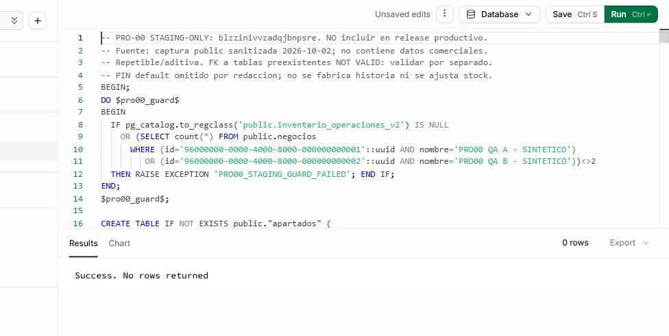
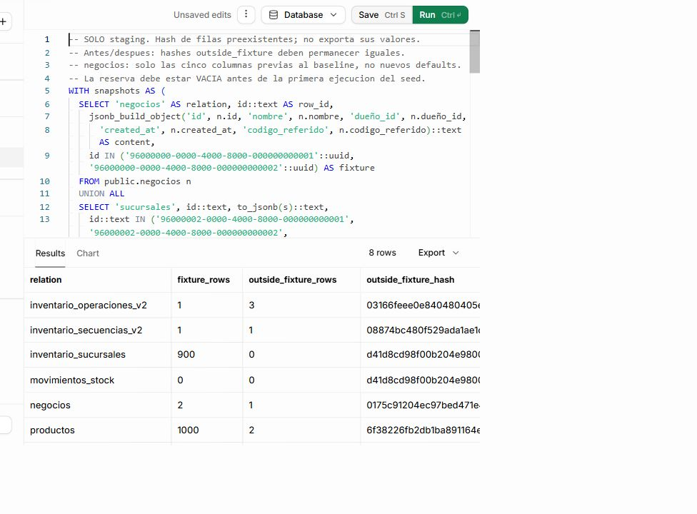
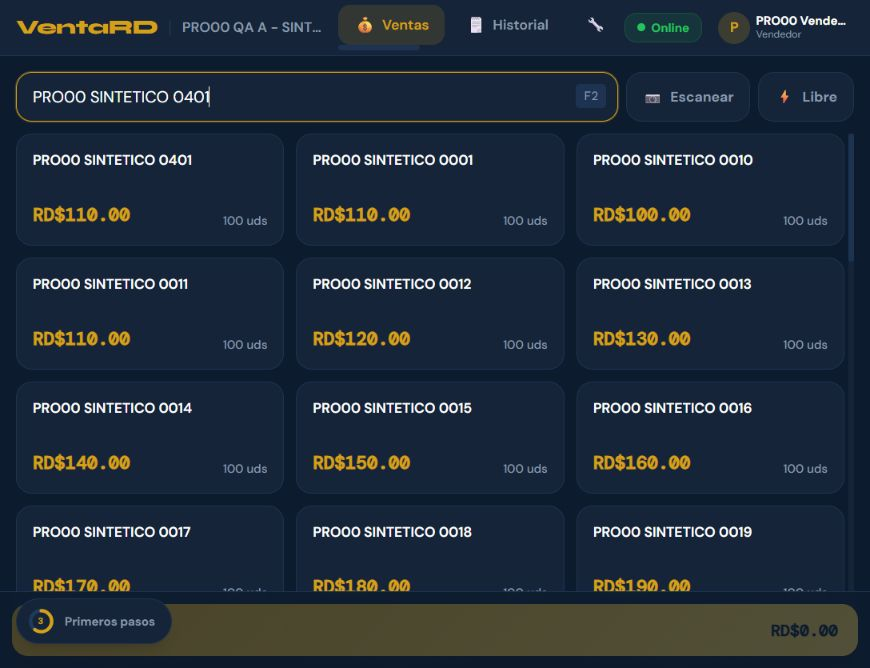
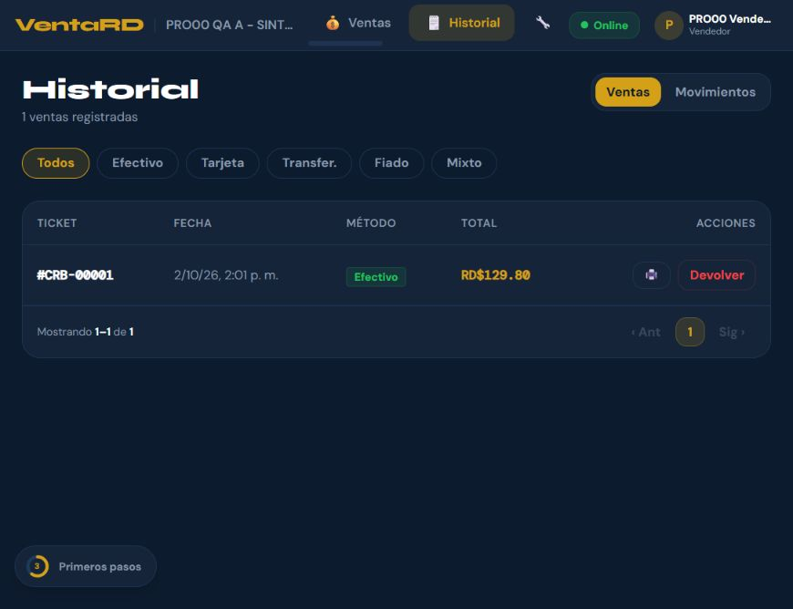

# PRO-00 — baseline aplicada, validación parcial

Fecha: 2026-10-02. **PRO-00 NO CERRADO. PRO-01 NO INICIADO. Sin release.**
Autorización específica recibida: aplicar únicamente en VentaRD Staging,
incluyendo policies/permisos QA, sin borrar ni tocar producción.
La lectura excepcional de metadata fuente ocurrió anteriormente; en esta
ejecución no se consultó ni modificó producción.

## Lo aplicado y cómo

1. `supabase/migrations/staging/20261002174025_pro00_staging_baseline.sql`.
   SHA256 final `D28EA0712B3D26314B483E07787B084A998DA0BCC7A433629CF9BDABF6060677`.
   Edición anterior aplicada: `64CB4E8CEC387A08E283EF98AC63F83D6BD7C26356AD403FBDA58CF676899302`.
   Única diferencia final: dos espacios finales en SELECT heredados eliminados,
   sin cambiar semántica ni reemplazar las funciones ya creadas.
   Creación CLI oficial 2.119.0; archivo completo aplicado en SQL Editor del
   proyecto `blzzinivvzadqjbnpsre`, dentro de BEGIN/COMMIT. No db push global,
   no cambio de project link, no registro artificial de historial CLI.
2. Archivo existente `supabase/migrations/20261002024759_fiado_abonos_contexto_caja.sql`.
   SHA256 `8B765A2F5F0C9EADD539A7BE36CE2902A26421F352EB8751F9F5C615A08D89EF`.
   Aplicado completo en transacción exclusivamente en Staging, sin modificar
   el archivo ni datos históricos. Añade caja_id/metodo_pago de nuevos abonos y
   subtotal ingreso_abonos_fiado. No demuestra aún aceptación comercial del abono.
3. `scripts/qa/pro00-fixture-config.sql`: plan_activo/pro y onboarding completado
   únicamente en los dos negocios QA propios, con guardias de ID/nombre/dueño.
   No cambios de credenciales/PIN ni activaciones de cuentas comerciales.

No hubo cero escrituras globales: hubo DDL aditivo, configuración sintética y
una venta QA real por interfaz. No se ejecutaron DELETE/TRUNCATE, reparaciones
históricas, reset de DB, nuevas migraciones v2, feed ni modificaciones del worker.

## Error encontrado / repetibilidad

Primera ejecución del baseline: FAIL `42830`, FK detalles_ventas_venta_id_fkey
antes de ventas_pkey. La transacción no alcanzó COMMIT; ROLLBACK explícito
confirmado. Prueba de regresión RED (11 PASS/1 FAIL), ordenación de todas las
PK/UNIQUE antes de cualquier FK, después 12/12 GREEN. Archivo regenerado
mediante apply_patch. Segunda aplicación: Success. Reaplicación idempotente
posterior: PASS, `Success. No rows returned`; no se recrearon funciones ni fixtures.
El diff staged detectó esos dos espacios del catálogo; prueba RED de formato
(13 PASS/1 FAIL), corrección acotada y final 14/14 GREEN del generador.

## Catálogo posterior realmente observado

SELECT de 17 secciones de catálogos, exportado mediante Copy as CSV visible.
No datos comerciales/Auth ni PIN. Fingerprint UTF-8 del resultado capturado:
`749eace5c5ecf3f5a5774876f1422ccbd53ec4e8655b7a1686f0bcf8c41b6807`,
263391 bytes. No se conservó un dump restaurable ni se declaró un pg_dump completo.
Comparación en memoria contra ambos CSV versionados; evidencia resumida aquí.

| Sección | Objetos |
| --- | ---: |
| Tablas public | 23 |
| Columnas | 292 |
| Constraints | 57 |
| Índices | 51 |
| Triggers (incluye Auth que llama public) | 9 |
| Policies | 47 |
| Grants de tablas | 454 |
| Funciones | 15 |
| Tablas public en Realtime | 1 |
| Secuencias / vistas / enums-domains / particiones public | 0 /0 /0 /0 |
| Extensions / schema-default grants / publication settings / routine grants | 5 /7 /1 /46 |

Resultado contra fuente: cero columnas faltantes, cero diferencias de tipos,
nullability o defaults no redactados; todos los nombres de constraints presentes.
Eso no equivale a comparar semánticamente cada policy/constraint/RPC ni a homologar
todo Auth, Storage, extensiones y configuración administrada.
Extras compatibles: 24 columnas de ledger/secuencias v2 y tres campos de abonos.
stock_actual continúa integer. Dinero conserva tipos numeric reales.
RLS habilitada en las 23 tablas; FORCE RLS de v2 preservado.
Las ocho funciones previas coinciden textualmente con el catálogo anterior.
Realtime sigue publicando únicamente movimientos_stock, no ledger v2.

Adaptaciones explícitas, no una copia bit-exacta de seguridad productiva:

- PIN default de la fuente redactado y omitido (default posterior NULL);
  no se importó el secreto ni se fijó uno nuevo. El fallback existente de la app
  sigue siendo un riesgo separado; no fue cambiado en este checkpoint.
- Siete funciones nuevas con search_path `pg_catalog, public, pg_temp`.
  authenticated ejecuta get_negocio_id/mis_negocio_ids/reservar_ncf/configurar_ncf;
  salud_negocios/total_ventas_negocio/handle_new_user no tienen grants cliente.
- Grants nuevos mínimos SELECT/INSERT/UPDATE/DELETE para authenticated,
  sin TRUNCATE/anon. Predicados de 46 policies fuente preservados y restringidos
  a authenticated; grants/policies legacy previos/v2 no se limpian en general.
- negocios_dueño_id_fkey y usuarios_negocio_user_id_fkey son NOT VALID sobre
  tablas preexistentes. Se comprueban escrituras futuras; no se afirmó integridad
  retrospectiva ni se validó/reparó automáticamente el pasado.
- Trigger residual de demora de concurrencia y helpers legacy sin search_path
  permanecen intactos. Nuestros IDs no activan la demora.

## Preservación

Antes y después de baseline/abonos/configuración/venta QA, se compararon conteos
y MD5 de las ocho tablas preexistentes fuera de fixtures. Igualdad observada:
ledger 3 /03166feee0e840480405e6c37ad02f4a;
secuencias 1 /08874bc480f529ada1ae1c8ba6e17ac9;
negocios 1 /0175c91204ec97bed471e418a0710767;
productos 2 /6f38226fb2db1ba891164e9602fc5479;
restantes cuatro 0 /d41d8cd98f00b204e9800998ecf8427e.

Para negocios se proyectan SOLO sus cinco columnas anteriores al baseline;
los defaults de columnas nuevas son una modificación aditiva legítima, no
un hash full-row idéntico. Las otras tablas conservan su proyección completa.
Ledger/movimientos/secuencias QA se excluyen por los dos negocio_id reservados
porque las operaciones generadas por el POS usan UUID aleatoria propia, no el
prefijo del seed. Antes de la venta existían cero ledger/contadores de esos tenants;
después, uno y uno. No se excluyeron las tres operaciones antiguas ni su contador.
MD5 es fingerprint diagnóstico, no auditoría criptográfica de todas las tablas.

## Build / código / pruebas

Snapshot 250 archivos SHA256
`df6c2c7fbad4aaa2ba7c8d70733d2cd8fc5ef72bb18f5c6925e5beb9348f426c`;
baseCommit `2d79b396cf52dad55516b7456691b5e5292f9ed5`, incluyendo cambios previos
sin commit. Build `qa-df6c2c7fb` aislada del dev original.

- `node --env-file=.env.qa-staging.local scripts/qa/pro00-runtime.mjs build`: PASS,
  compilación 14,7 s, TypeScript 14,6 s, 45/45 páginas, finalización exit 0.
  Advertencias Sentry disableLogger/Browserslist registradas, no corregidas.
- Servidores QA en 127.0.0.1:3101/3102, solo loopback. `/api/version` devuelve
  `qa-df6c2c7fb` en ambos. No se repuntó 3001 ni el .env original.
- Scan de 135 archivos cliente: ninguna aparición de los bytes de la clave
  server QA ni de la URL del backend productivo. Clave privada cargada desde
  .env ignorado, nunca impresa. El scan no demuestra ausencia universal de PII.
- Suite `npm test`: 55 archivos/354 tests PASS, 4,81 s; repetición final 5,19 s,
  ambas exit 0.
  Ocho caracterizaciones AUD reproducen riesgos, no los corrigen.
- `npm run typecheck`: PASS, exit 0.
- Helpers baseline/runtime final: 21/21 PASS, 126,65 ms, incluye igualdad del
  archivo versionado con el generador, regresión de orden PK/FK y whitespace.
- ESLint de cuatro archivos QA: PASS, exit 0. No lint global declarado.
- `git diff --check` y `git diff --cached --check` final: PASS, exit 0;
  avisos CRLF/ignore previos no son fallos. El fallo inicial staged se corrigió.
- Hashes worker/page/Dexie/next.config iguales al inicio; cero edición de código
  productivo en este trabajo. No build de producción aprobado para release.

## Uso real A → remoto → B

A=dueño, B=vendedor (login introducido por usuario), mismo tenant QA A y A1,
dos orígenes/sesiones distintos en un solo equipo; no dos PCs físicas.
Admin pendiente por contraseña incorrecta reportada; no se cambió.
Fixtures: 1000 productos, 900 inventarios branch, dos tenants/3 sucursales.
Productos IMPARES BRANCH, PARES GLOBAL; no los primeros 400 contra los siguientes.

Producto `96000001-0000-4000-8000-000000000401`, precio 110 +ITBIS 19,80:

| Etapa | Resultado observado |
| --- | --- |
| Antes de venta, A | 60 unidades branch |
| Antes de venta, B | 100, proyección global incorrecta para A1 |
| Cobro sintético efectivo exacto en A | Ticket CRB-00001, total 129,80; éxito local |
| Después local A | 59 |
| Remoto | venta f8b94e5a-26e7-47a6-94db-4414de188187; A1=59, A2=40, global=99 |
| Ledger v2 | operation 48a28f8e-6dbd-469a-b2ab-1c492e517cca; BRANCH; efecto -1; before=60, after=59; sequence=1 |
| B sin recarga | 100 |
| B después de recarga | 100 |
| Historial B | Una venta, CRB-00001 /efectivo /129,80 visible |

Hash del payload remoto
`bb8fb683118c20cb9bbef415c517f0ce8d753cf5d01bf643f1b141ff152605bd`.
No movimiento legacy para ese producto; no segundo cobro/replay ni reparación.
La venta se hizo sin apertura de turno en este recorrido; no aceptación de reglas
de caja, cierre, impresión física, NCF o recibo de venta agregado completo.

**Convergencia stock FAIL**, no confundida con llegada del historial:

- Evidencia: policies capturadas de inventario_sucursales consultan dueño_id o
  get_negocio_id (solo dueño). No contemplan correctamente membresía vendedor.
  Es consistente con fallback al stock global observado; no prueba exhaustiva HTTP
  de todos los roles. No se creó policy de reparación ni se deshabilitó RLS.
- v2 remoto actualiza stock sin actualizar fecha_actualizacion y sin evento
  movimientos_stock; ledger no está publicado. Esto es un riesgo verificable
  en la definición real preservada, compatible con pull incremental estancado.
  La causalidad completa debe instrumentarse en el checkpoint de convergencia;
  no afirmar que todo el desfase proviene únicamente de RLS o caché.
- No métricas p50/p95/p99 inventadas a partir del tiempo de llamadas de automatización.

## Gate restante / límites

Preparación DB/build/usuarios/fixtures ya aplicada; homologación NO aprobada.
PRO-00 se mantiene parcial: completar admin y dueño B, RLS/aislamiento por HTTP
cross-tenant/cross-branch sin service_role, volumen/latencia de baseline y
arranque frío con bloqueo real de red HTTPS/equipos representativos.
La preparación local HTTP no valida el runtimeCaching HTTPS ni offline productivo.
No cargar filas reales en fixtures, no borrar caches/pending para ocultar fallos.
PRO-01 y siguientes no iniciados. Ningún usuario productivo necesita acción.
